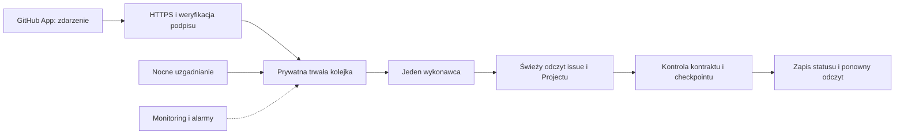

# Warianty uruchomienia centralnego kontrolera FLOW

Status: **decyzja właściciela z 4.11.2026 — wariant B, centralny wykonawca na Mikrusie**. Architektura nie jest jeszcze wdrożona; szczegóły magazynu checkpointów i planu wdrożenia pozostają otwarte. Issue: #75; realizacja kontrolera pozostaje w #5, nocnego uzgadniania w #6, a dostępu i rotacji w #48. Ten dokument nie zmienia istniejących uzgodnień o rolach, wspólnym smoke ani decyzji właściciela o zamknięciu issue.

## Co wiemy z prób

Standard aktualizuje wcześniejszy zapis o znaczniku w treści issue do uzgodnionego kierunku chronionej gałęzi technicznej. Ewentualne przejście na bazę pozostaje propozycją w tym dokumencie.

- Jedna GitHub App wysłała podpisane syntetyczne `repository_dispatch` z rzeczywistego prywatnego projektu do ograniczonego odbiornika na Mikrusie. Po zapisie, restarcie odbiornika i ponowieniu w kolejce pozostał jeden wpis; to nie był test zwykłego issue ani zapisu statusu (#71).
- Ta sama dostawa przeszła przez istniejącą domenę infrastruktury i Cloudflare (#73). Po restarcie odbiornika odnotowano krótkie `502`. Pełny restart serwera, odzyskiwanie niedostępności i przełączenie projektów nie zostały sprawdzone. Webhook aplikacji jest wyłączony; aktualna trasa dopuszcza jedynie `repository_dispatch` i `ping`.
- W trakcie próby trzy odizolowane procesy zajmowały łącznie około 51 MiB; to pojedynczy pomiar z tymczasowym tunelem, nie wymaganie pamięci ani pomiar docelowego kontrolera. Na serwerze nie stwierdzono osobnej instalacji Node.js; działa Docker i Python. Dostępne zasoby i koszty trzeba potwierdzić przy wdrożeniu.
- Draft PR #25 dla #5 zawiera częściowe komponenty JavaScript. Model v3 przechowuje checkpoint na chronionych refach Git; nie jest działającym runnerem ani gotowym magazynem SQLite. Zbadano pierwszy cykl i odrębne transporty, nie cały cykl wszystkich przekazań.

## Trzy główne warianty

| | A. Centralne GitHub Actions | B. Centralny kontroler na Mikrusie | C. Mikrus jako odbiornik, Actions jako wykonawca |
|---|---|---|---|
| Sygnał | Projekt uruchamia centralny relay; obecny wzorzec wymaga konfiguracji nadawcy i tokenu w projektach. | Webhook jednej App dla zainstalowanych repozytoriów; nie wymaga per-repo tokenu relay do wysłania zdarzenia. Dostęp App do danego repo nadal trzeba zapewnić. | Jedna App wysyła webhook na serwer; serwer budzi centralny workflow Actions. |
| Stan i kolejka | Prywatny stan musi być dostępny runnerowi; obecny model rozważa chronione refy i osobny prywatny magazyn. | Jedna prywatna baza na serwerze jest możliwa, lecz wymaga nowego adaptera, ochrony i odtwarzania. | Serwer musi mieć trwały bufor, a Actions stan checkpointu; trzeba rozliczać przejście między systemami. |
| Uprawnienia | PAT Projectu i klucz App w chronionym środowisku Actions; relay wymaga osobnego poświadczenia. | PAT Projectu, klucz App i sekret webhooka centralnie na serwerze; lokalne odczyty muszą być ściśle odseparowane. | Sekret webhooka i poświadczenie do wywołania Actions na serwerze, PAT i App w Actions. |
| Zalety | Mniej usług do utrzymania; CI i logi w GitHubie; można wykorzystać istniejące prace nad Actions. | Jeden punkt odbioru i diagnozy dla projektów; mniej konfiguracji w repo projektów; baza i kolejka blisko wykonawcy. | Pozostawia wykonanie na GitHubie i usuwa repozytoriom potrzebę wysyłania relay. |
| Koszty i ryzyka | Konfiguracja nadawcy/sekretu, przepełnienie lub zastąpienie oczekujących przebiegów, ochrona prywatnego stanu; trzeba zaprojektować odzyskiwanie. | Właściciel utrzymuje usługę, kopie, monitoring, aktualizacje i serwerowe poświadczenia; awaria VPS może zatrzymać wszystkie projekty. | Dwa niezależne systemy pracy, więcej poświadczeń oraz granica, na której trzeba odtwarzać niepewny wynik wywołania. |

GitHub Actions domyślnie utrzymuje jeden oczekujący przebieg w grupie. `queue: max` pozwala obecnie na maksymalnie 100 oczekujących; kolejne są anulowane. Żaden z tych trybów samodzielnie nie jest bezstratną kolejką aplikacyjną. [Dokumentacja GitHub](https://docs.github.com/en/actions/how-tos/write-workflows/choose-when-workflows-run/control-workflow-concurrency).

Widoczność repozytorium kodu i miejsce stanu to niezależne decyzje. Publiczne repo z kodem oraz prywatny stan na VPS są możliwe. Jeśli używamy reusable workflows z repozytoriów publicznych, zgodnie z [tabelą GitHub](https://docs.github.com/en/actions/reference/workflows-and-actions/reusing-workflow-configurations) repozytorium wywoływanego workflow musi być publiczne. Nie wnioskujemy stąd, że całe rozwiązanie musi korzystać z reusable workflows ani że obecny prywatny magazyn można już usunąć.

## Wybrany kierunek

**Właściciel wybrał wariant B: centralny wykonawca na Mikrusie.** Actions mogą nadal obsługiwać CI i niezależny monitoring, ale nie stanowią drugiego wykonawcy statusów. Bezpośredni webhook App ma upraszczać wejście dla projektów. Wybór zwiększa zależność od VPS i obowiązki operacyjne; nie oznacza zatwierdzenia bazy checkpointów, migracji poświadczeń ani uruchomienia produkcyjnych zapisów.

Schemat przedstawia **docelowy kierunek do zaprojektowania i wdrożenia**. Obecny kod i działający punkt testowy realizują tylko ograniczoną część wejścia.

## Zasady bezpiecznej realizacji wariantu B

1. Odbiornik potwierdza dostarczenie dopiero po sprawdzeniu podpisu i trwałym zapisie minimalnej informacji. ID dostarczenia służy deduplikacji transportu; ID komentarza weryfikuje ciągłość przekazań. Nie zapisujemy pełnych payloadów, tekstu issue ani poświadczeń w logach. Metadane prywatnych projektów i baza także są prywatne. Spike odrzuca powtórny identyczny podpis pod innym ID dostarczenia, co może odrzucić dwa prawidłowe zdarzenia o identycznej treści; docelowy mechanizm wymaga nowego projektu i testów.
2. Zdarzenie budzi pracę, a nie stanowi samodzielnej decyzji o statusie. Wykonawca ponownie czyta bieżące issue, zaufane przekazanie, stan karty i checkpoint. Należy uwzględnić kolejność i powtórzenia zdarzeń, zniknięcie lub zmianę komentarza, zamknięcie oraz ponowne otwarcie issue. Nocna samonaprawa sprawdza uzasadnione rozbieżności nawet bez nowego zdarzenia.
3. Jeden globalny wykonawca i jedna wspólna kolejka zapisów obejmują wszystkie projekty i tablice oraz pracę bieżącą, nocną i ręczne wznowienia; równoległych writerów nie wprowadzamy bez nowej decyzji. Trzeba zaprojektować blokady, wznowienie po awarii, pauzę do ręcznej korekty i brak drugiego aktywnego kontrolera. Stan niepewnego żądania zapisu zostaje zapisany; po uzgodnionym czasie i ponownym odczycie możliwe jest wznowienie. GitHub nie oferuje tu warunkowego zapisu statusu, więc bardzo opóźnione stare żądanie nadal może nadpisać późniejsze — to wcześniej zaakceptowana granica, nie usunięte ryzyko.
4. SQLite może służyć jako kolejka i checkpoint tylko po zaprojektowaniu transakcji, schematu, integralności, ochrony przed cofnięciem i scenariuszy odtwarzania. Trzeba uzgodnić i przetestować szyfrowaną kopię poza VPS, retencję i odzyskanie danych **razem z kluczami**; w trybie WAL nie wystarcza kopiowanie jednego aktywnego pliku. Po odtworzeniu ze starszej kopii nie wolno automatycznie zakładać, że historia checkpointów jest kompletna.
5. GitHub [nie ponawia automatycznie nieudanych dostaw](https://docs.github.com/en/webhooks/using-webhooks/handling-failed-webhook-deliveries). Niezależny monitoring wykrywa awarię, a mechanizm odzyskiwania rozlicza dostawy i ponawia je w sposób kontrolowany. GitHub opisuje ręczne ponowienia dla dostaw z ostatnich [trzech dni](https://docs.github.com/en/webhooks/testing-and-troubleshooting-webhooks/redelivering-webhooks); także przy krótszych przerwach potrzebne są alarm i nocne uzgodnienie aktualnego stanu. Redelivery nie odtworzy zdarzeń z okresu wyłączonego webhooka, braku subskrypcji lub dostępu App. Samo redelivery nie gwarantuje wykrycia ani pełnego odtworzenia przyjętej kolejki po cofnięciu bazy, chociaż część wcześniejszych udanych dostaw może być dostępna do ponowienia. Usuniętego przekazania, którego system nigdy nie zaobserwował, nie można obiecać odzyskać; takie sytuacje wymagają wyjaśnienia, a nie automatycznego zgadywania. Po dłuższej awarii potrzebne jest osobne uzgodnienie aktualnego stanu z GitHubem oraz alarm, bez obietnicy odzyskania pełnej historii.
6. Na serwerze potrzebne są co najmniej: sekret webhooka do weryfikacji, klucz prywatny App do krótkotrwałych tokenów instalacyjnych i klasyczny PAT użytkownika do osobistych Projectów w dotychczas sprawdzonym modelu. Nie zakładamy możliwości odzyskania wartości z GitHub Actions. Sposób wprowadzenia, rozdział procesów, uprawnienia, kopie i rotację trzeba osobno zaprojektować. Obecna App ma silne uprawnienie administracyjne w objętych repozytoriach; wyciek jej klucza może mieć szerokie skutki, także dla dostępności repozytoriów. Nie przenosić żadnych poświadczeń przed przygotowaniem i weryfikacją ścieżki.
7. Jeden nowy projekt wymaga instalacji App, powiązania z tablicą i wiarygodnej rejestracji. Docelowy skill powinien wykonać możliwe automatyczne kroki i jasno wskazać te wymagające udziału właściciela. Nie obiecywać automatycznego dodania repo do instalacji bez potwierdzenia uprawnień API.

## Co wykorzystać, a co zbudować

- **Do ponownej walidacji i użycia:** parser i wybór `[FLOW]`, stronicowany odczyt komentarzy, transporty GitHub/App i Project, części planowania cyklu, odczyt po zapisie oraz model 120-sekundowego oczekiwania z #5. Komponenty nie są w pełni zintegrowanym kontrolerem.
- **Do zaprojektowania od nowa lub adaptacji:** przyjęcie i odzyskiwanie rzeczywistych webhooków, kolejka i wyłączność, serwerowy runtime Node, rejestracja projektów, uruchamianie przy starcie, dostęp i rotacja poświadczeń, pełny cykl kolejnych handoffów/reopen oraz nocne uzgadnianie.
- **Osobna decyzja techniczna:** zachować checkpointy na chronionych refach Git czy opracować prywatny stan w bazie. Zamiana wymaga nowego adaptera i dowodu inicjalizacji, integralności, wykrywania usunięć oraz odtwarzania; nie jest samą zmianą miejsca zapisu. Weryfikacja musi objąć publiczne i prywatne projekty bez ujawniania ich metadanych.

Przed przełączeniem: sprawdzić faktyczny runtime i zasoby, przetestować awarię odbiornika, workerów, GitHuba i Projectu, restore z kopii oraz izolację wielu projektów; następnie uzgodnić przełączenie właściciela statusów i wspólny smoke. Nie usuwać poprzednich tokenów, relay ani magazynów przed potwierdzonym przejęciem ich funkcji.
